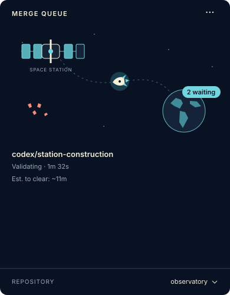

# merge-queue: a local Git merge queue for AI coding agents

Run Claude Code, OpenAI Codex, or other coding agents in separate Git worktrees, then integrate their committed work through a shared local merge queue. **merge-queue validates the combined candidate against the current target branch before landing it with a guarded fast-forward.**

Use the CLI from a terminal, connect agents through the Model Context Protocol (MCP), or watch progress in the optional native macOS menu-bar app. The queue engine is deterministic: it calls no model and needs no AI provider API key.

**Python 3.11+ · POSIX · MIT license · Optional SwiftUI app for macOS 13+**

[Quick start](#quick-start) · [Use cases](#when-to-use-merge-queue) · [Claude and Codex](#use-with-claude-code-and-codex) · [macOS app](#native-macos-menu-bar-app) · [Documentation](#documentation)

## When to use merge-queue

Parallel work is useful until several contributors try to update the same integration checkout. A branch can pass its own tests and still fail when combined with a change that landed moments earlier. merge-queue prepares an isolated candidate, checks the combined result, and refreshes it if the target moves.

| Situation | How the queue helps |
|---|---|
| Several Claude Code or Codex tasks work on one repository | Each task keeps its own worktree; the normal queue serializes integration into the shared target. |
| A developer works alongside autonomous coding agents | Humans and agents use the same committed-change workflow and project-owned validation rules. |
| Two individually valid changes interact | Validation runs after rebasing onto the current target; a moved target triggers refresh and revalidation. |
| A long agent session disconnects | The request and evidence are durable. Reconnect to the same receipt instead of submitting the work again. |
| One machine has several active repositories | Repositories have separate queue state and locks. One MCP configuration can discover every installed repository. |
| You want a quick visual status check | The macOS menu-bar app shows one repository, its active request, elapsed time, waiting work, and recent results. |
| Small presentation fixes should avoid a broad validation backlog | An optional operator-owned classifier routes eligible changes through a fast lane with focused checks and the same publication guards. |

This is a **local integration tool** for a single machine. It does not manage GitHub pull requests, replace hosted CI, provide a distributed queue, or launch your coding agents. Each repository installation has one integration checkout and one configured target branch, usually `main`.

## How it works

```text
committed worktree
       |
       v
stable request ID + durable receipt
       |
       v
normal FIFO queue / trusted inline fast lane
       |
       v
isolated candidate rebased onto current target
       |
       v
project validation policy checks the combined result
       |
       v
fresh checkout checks -> local git merge --ff-only
```

The normal FIFO scheduler is [Block's agent-task-queue (`tq`)](https://github.com/block/agent-task-queue), used as an unmodified external command. merge-queue adds exact-commit receipts, policy-driven validation, recovery, Git publication guards, and an MCP interface. It is an independent project, not a fork of `tq`.

## Install

You need Git, Python 3.11 or newer, and [uv](https://docs.astral.sh/uv/getting-started/installation/). The CLI uses POSIX file locks and process groups; development and acceptance testing have been on macOS. The desktop app is macOS-only.

Install the pinned scheduler and this repository's package:

```sh
uv tool install agent-task-queue==0.4.1
uv tool install 'git+https://github.com/chlwys/merge-queue.git'
merge-queue --help
merge-queue-mcp --help
```

For a reviewed, reproducible deployment, pin the Git URL to a chosen commit. The Git-source installation is intentional; do not assume a package with the same name on a package index is this project.

The package installs its pinned MCP and file-event dependencies. Install it into a stable tool environment: repository hooks and runners must not point into a temporary directory or disposable linked worktree.

## Quick start

### 1. Choose the target checkout and a validation policy

Start in the clean checkout that owns your target branch. Other contributors will work in separate worktrees.

```sh
cd /path/to/your-repository
mkdir -p .merge-queue
```

Create `.merge-queue/policy.json`. This example runs a Python project's unit tests for **every** changed path; replace the command with your project's real gate:

```json
{
  "version": 1,
  "rules": [{"match": ["*"], "checks": ["tests"]}],
  "checks": {
    "tests": {
      "argv": ["python3", "-m", "unittest", "discover", "-s", "tests"],
      "timeout": 900
    }
  }
}
```

Checks run in an isolated candidate worktree. Make sure the required executable and dependencies are available there. For monorepos and selective dependency setup, use the documented [validation policy and planner protocol](docs/policy.md).

### 2. Register the repository

```sh
git add -- .merge-queue/policy.json
merge-queue policy check
git commit -m "Configure merge queue validation"
merge-queue install
merge-queue doctor
```

Commit the policy so it is present in candidates and does not leave an unknown untracked file in the integration checkout. The default target is `main`. Installation writes shared `mergequeue.*` Git configuration, a registry entry, and two Git hooks. Existing hooks are chained. See [operations](docs/operations.md) for another target, runner supervision, runtime path allowances, upgrades, and uninstalling.

Unmatched policy paths fail closed. Keep `merge-queue policy check` in your project checks so newly tracked paths do not surprise the queue later.

### 3. Work, commit, and submit once

Create a task worktree from the target, then make and check your changes there:

```sh
git worktree add -b feature/search ../your-repository-search main
cd ../your-repository-search
# Edit and check your changes, then stage the specific changed paths.
git add -- path/to/changed-file
git commit -m "Add search filters"

merge-queue submit --owner search-task --request-id search-task-001 --wait --timeout 7200
```

Choose and save a unique request ID and a stable owner ID before submission. Both accept 1–64 letters, digits, periods, underscores, and hyphens, starting with a letter or digit. The submitted unit is the exact committed `HEAD`; uncommitted edits are not included. A runner starts on demand unless your installation already supervises one.

Exit `0` means the request landed **locally**. It does not mean a remote push happened.

### 4. Recover the same receipt after interruption

```sh
merge-queue result search-task-001 --owner search-task --wait --timeout 7200
```

A timeout, disconnected client, or background task handle does not justify a duplicate submission. Reattach to the saved receipt. For a terminal failure, inspect its result and inbox, repair and commit when required, then retry the failed receipt with a new request ID:

```sh
merge-queue result search-task-001 --json
merge-queue inbox --owner search-task --json
# Repair, check, and commit before retrying an owner failure.
merge-queue retry search-task-001 --owner search-task --new-request-id search-task-002 --wait --timeout 7200
```

Keep a single wait pending rather than polling `status` or `result`. CLI and MCP waits use native filesystem notifications.

## Everyday commands

| Command | Purpose |
|---|---|
| `merge-queue status --json` | Take one repository queue snapshot. |
| `merge-queue result REQUEST_ID --json` | Inspect one receipt and its outcome. |
| `merge-queue result REQUEST_ID --wait --timeout 7200` | Observe an existing receipt until terminal or the actual queue timeout. |
| `merge-queue inbox --json` | Read action and evidence for the current owner. |
| `merge-queue retry REQUEST_ID --new-request-id NEW_ID --wait` | Retry a failed request after the required repair. |
| `merge-queue doctor` | Diagnose installation, queue, and publication readiness. |
| `merge-queue policy check` | Check policy structure and tracked-file coverage. |
| `merge-queue uninstall` | Remove queue configuration/hooks while preserving durable state. |

| Exit code | Meaning |
|---|---|
| `0` | Landed |
| `10` | Owner action, such as a conflict or failed validation |
| `11` | Operator action, such as checkout or policy readiness |
| `12` | Receipt superseded by a retry |
| `20` | Infrastructure failure |
| `30` | Still pending |

See [architecture and exit codes](docs/architecture.md) for the complete state model and other command errors.

## Use with Claude Code and Codex

Agents can use the CLI directly or connect the installed `merge-queue-mcp` stdio server. A single server configuration can serve all registered repositories; worktrees of the same repository share its queue. Different repositories retain independent state and normal FIFO queues.

The MCP interface is small:

| Tool | Purpose |
|---|---|
| `submit` | Submit committed work once and wait on its durable receipt. |
| `wait_for_result` | Reattach to your receipt after a real interruption. |
| `retry` | Retry your failed receipt after repair, using a new saved ID. |
| `watch_request` | Observe another owner's request without resubmitting it. |
| `wait_for_queue_empty` | Wait for one repository's nonterminal requests to drain. |
| `list_queues` | Discover registered repositories in one snapshot. |

Follow the [Claude Code and Codex setup guide](docs/agents.md) for copyable client configurations, timeouts, and a repository instruction snippet. [MCP reference](docs/mcp.md) documents every tool and reconnect contract.

For contributors to this project, [AGENTS.md](AGENTS.md) provides the source map and checks. [CLAUDE.md](CLAUDE.md) imports the same instructions. [llms.txt](llms.txt) is a compact documentation index for tools or readers that choose to consume it; it is not required for the queue to work.

## Native macOS menu-bar app

The optional SwiftUI app lets you inspect the queue without returning to a terminal. It shows one repository at a time, with a small repository selector at the bottom. The default Orbital theme draws a satellite-to-Earth route, rocket, active-request dot, readable multiline title, lifecycle stage, and elapsed time. A Minimal theme is included; themes and artwork are separate from queue reading.



*Orbital theme illustration with synthetic request names.*

Build it from a clone with Apple's Command Line Tools or Xcode:

```sh
git clone https://github.com/chlwys/merge-queue.git
cd merge-queue/apps/macos
scripts/build-app.sh
open "dist/Merge Queue.app"
```

No Electron, bundled browser, or third-party Swift package is required. The resulting app is ad-hoc signed for local use; this repository does not currently provide a notarized download. The monitor reads queue records and cannot submit, cancel, or change a merge.

Observation runs while the panel is open, using native file events. Reopening refreshes the snapshot. Only an active request enables the once-per-second elapsed label. Route positions indicate preparing, validating, and landing stages, not a measured percentage or an ETA.

See the [macOS app guide](apps/macos/README.md) for state-root configuration, theme boundaries, build-tool compatibility, previews, and tests.

## Safety model

- **Combined-candidate validation:** the policy runs against a candidate rebased onto the current target, then runs again if the candidate must be refreshed.
- **Trusted policy ownership:** the integration checkout supplies the policy. A submitted candidate cannot change the rules that judge itself.
- **Fresh publication checks:** guarded local fast-forwards check branch, tracked cleanliness, unrecognized untracked files, and path overlap with runtime data. The queue never resets your integration checkout to manufacture cleanliness.
- **Durable recovery:** receipts, acceptance intents, and process identities support reconnect and bounded crash recovery. Failures return evidence to the owner or operator.
- **Coordinated local Git:** ordinary commits and merges remain possible while no queue publication holds the integration lock. The hooks are same-user coordination guards, not a security sandbox for untrusted contributors.
- **Separate remote publication:** target pushes require explicit approval via `MERGE_QUEUE_PUSH_APPROVED=1`. Local queue success does not authorize publishing code remotely.
- **One local machine:** one integration checkout and configured target per repository installation. There is no distributed runner, multi-host coordination, or guarantee that a closed agent session will be awakened.

Project validation commands execute code from the candidate. Use trusted repositories and policies appropriate to your environment. Details and recovery instructions are in [architecture](docs/architecture.md) and [operations](docs/operations.md).

## Documentation

| Guide | Contents |
|---|---|
| [Agent adoption](docs/agents.md) | Claude Code and Codex setup, portable instructions, receipt discipline |
| [MCP reference](docs/mcp.md) | Tool arguments, events, timeouts, ownership, reconnect behavior |
| [Operations](docs/operations.md) | Installation, state roots, registry, supervision, direct Git, uninstall |
| [Validation policy](docs/policy.md) | Rules, checks, selective setup, trusted inline fast lane |
| [Architecture](docs/architecture.md) | Request lifecycle, scheduling, candidate validation, publication, recovery |
| [macOS app](apps/macos/README.md) | Native monitor build, themes, data access, visual development |
| [Example policy](examples/policy.example.json) | An adaptable starting point, not a universal production gate |
| [Agent index](llms.txt) | Short machine-readable map of the documentation |

## Development and contributing

```sh
uv sync --locked
uv run python -m unittest discover -s tests
python3 scripts/audit_publication.py
```

The Python suite requires the real `tq` 0.4.1 command. Tests create temporary Git repositories with isolated HOME, state roots, and scheduler data. They do not use your installed live queues. For native app tests with Swift 6:

```sh
cd apps/macos
scripts/swift.sh test --disable-xctest
```

Keep behavior changes focused, add relevant regression coverage, and update the matching guide. Preserve receipt ownership, target-freshness checks, policy authority, and publication guards. Use [GitHub issues](https://github.com/chlwys/merge-queue/issues) for bugs and feature requests; include versions, the failure type, and redacted evidence rather than private source or credentials.

See [CONTRIBUTING.md](CONTRIBUTING.md) for contribution and privacy checks, and [SECURITY.md](SECURITY.md) for vulnerability reporting.

## License and credits

merge-queue is [MIT licensed](LICENSE). Scheduling uses Block's [agent-task-queue](https://github.com/block/agent-task-queue) 0.4.1, an unmodified Apache-2.0 external dependency. The native app uses Apple's SwiftUI and AppKit. This project is independent of Block, Anthropic, and OpenAI.
